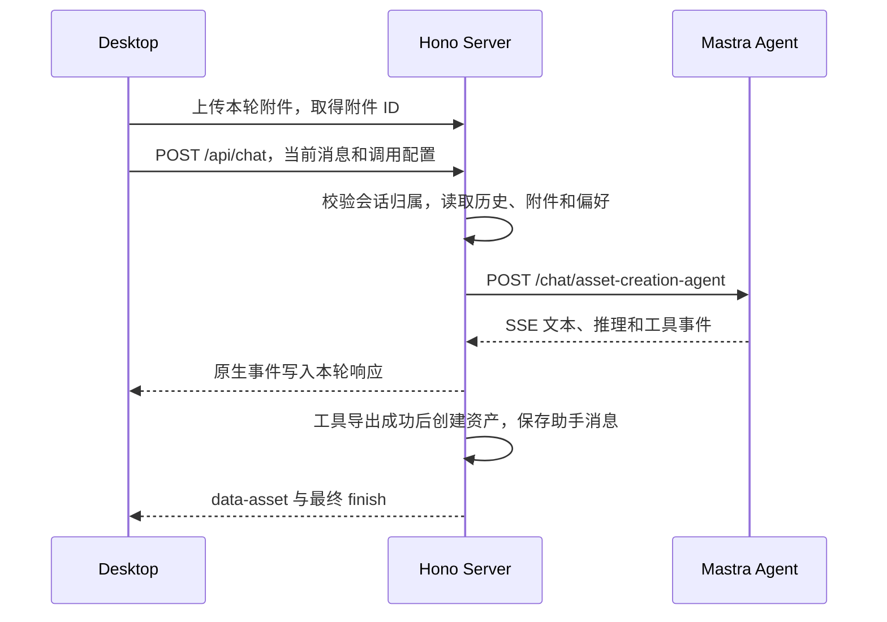
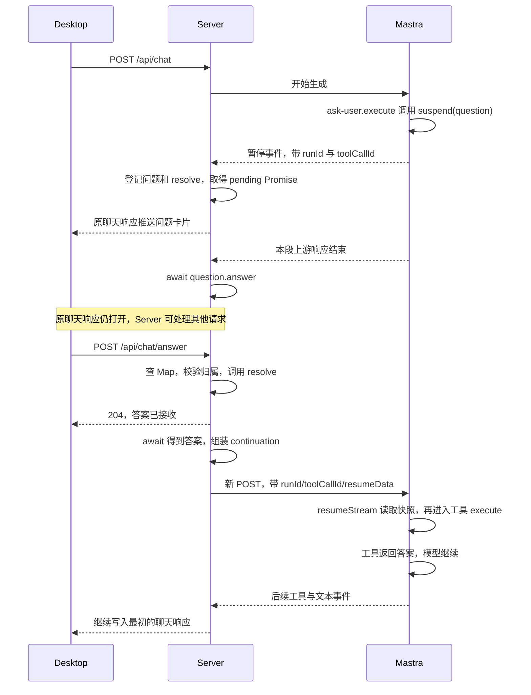

# 聊天数据流与用户回答后的恢复

这份说明对应当前工程。先看时序图，再打开源码里的同名函数，可以把 HTTP 请求、Promise 与 Mastra 的暂停快照联系起来。

## 源码阅读顺序

| 文件 | 重点位置 |
|---|---|
| `apps/desktop/src/renderer/src/features/chat/Composer.tsx` | submit 上传附件后提交消息 |
| `apps/desktop/src/renderer/src/features/chat/ChatView.tsx` | sendMessage、prepareSendMessagesRequest、useChat |
| `apps/server/src/routes/chat.ts` | POST /chat、pendingQuestions、POST /chat/answer |
| `apps/server/src/agent-client.ts` | streamAgent 的 while、yield、await question.answer |
| `apps/agent/src/mastra/index.ts` | RequestContext 中间件和原生 chatRoute |
| `apps/agent/src/mastra/agents/agent.ts` | 动态 model、ask-user.execute 和 defaultOptions |
| `apps/desktop/src/renderer/src/features/chat/MessageParts.tsx` | 按 part 类型展示正文、工具和问题 |
| `apps/desktop/src/renderer/src/features/chat/UserQuestion.tsx` | 选择选项、自定义输入和 submit |
| `apps/desktop/src/renderer/src/api/client.ts` | answerQuestion、confirmTool、getMessages |

## 一次消息如何到达模型



### Desktop 提交什么

Composer 在点发送后先上传文件。ChatView.sendMessage 接到文本和上传结果后调用 chat.sendMessage，AI SDK 把用户消息加入本地消息列表，再通过 DefaultChatTransport 发请求。

prepareSendMessagesRequest 负责组装 POST /api/chat 的 JSON 请求体。

| 字段 | 来源与用途 |
|---|---|
| conversationId | 当前会话，用于历史、鉴权和资产归属 |
| clientTurnId | 每次发送创建，重试复用，防止重复保存同一轮 |
| messages | 只带本轮用户消息，使用 AI SDK 的 role/parts 格式 |
| attachmentIds | 指向先前上传的真实文件 |
| model、apiKey | 本轮的服务商、模型地址和调用密钥 |
| toolApproval | 本轮使用手动或自动确认 |

一条 UIMessage 的 parts 可同时包含 text 和 data-attachment。data-attachment 给桌面显示文件名、类型和预览地址，attachmentIds 给 Server 查找存储里的文件。

transport 回调通过 ref 读取当前模型和确认方式，避免长期存在的回调一直使用创建时的旧值。

### Server 为什么要补齐数据

readSubmittedTurn 校验当前消息和附件引用，并得到本轮文本及待保存的用户消息片段。Server 校验用户和会话归属后组装 AgentServiceRequest。

| 来源 | 整理后的内容 | 用途 |
|---|---|---|
| 当前消息 | 文本 | 本轮任务 |
| 数据库历史 | 最近 39 条已完成消息，加本轮消息 | 连续对话上下文 |
| 历史建模工具输出 | 上一版完整脚本描述 | 修改时读取原来的 source |
| 历史提问工具输出 | 用户已提交的答案 | 下一轮继续沿用需求 |
| 本轮附件 | 文档文本、图片 data URL | 提供实际参考内容 |
| 当前用户偏好 | key/value 数组 | 给 analyze-input 读取 |
| Desktop 调用配置 | model、apiKey、toolApproval | 选择模型并决定是否审批 |

Desktop 只发送当前消息。历史从 Server 已保存的记录读取，让请求体体积可控，并便于校验附件归属。

prepareConversationInput 从磁盘读取选中的附件，将文档提取为文本，将图片转成 data URL。图片预览地址依赖本地登录 Cookie，模型输入使用这里读取的图片字节。

shared 中的 Zod schema 负责本项目 HTTP 入参的字段、长度和默认值校验。AgentServiceRequest 整理本轮调用需要的数据，返回流仍沿用 AI SDK 事件格式。

### messages 和 agent3d 的区别

streamAgent 把历史的 role/content 转成 Mastra chatRoute 接受的 UIMessage。文本放进 text part，本轮图片放进 file part。

- messages 携带对话内容和本轮图片，供模型生成时使用。
- agent3d 携带模型配置、密钥、确认模式、文档、图片说明和偏好，供应用代码使用。

Agent 路由中间件校验 agent3d 后执行 requestContext.set('agent3d', agent3d)。动态 model 使用其中的模型与密钥创建 provider，工具及 defaultOptions 也能读到本轮配置。

RequestContext 保存字段后，字段是否进入模型上下文取决于具体代码。比如 analyze-input 被调用后返回文档文本和偏好，模型随后通过工具结果看到它们。图片字节已经在 messages 里，agent3d.images 只保留名称和类型。

## 返回流如何显示

SSE 是 HTTP 响应体中持续到达的事件。一次网络读取可能只有半个事件，也可能包含多个事件，parseJsonEventStream 负责按 SSE 边界拆出 JSON 并校验。

| 事件 | UI 变化 |
|---|---|
| text-start / text-delta / text-end | 逐步更新正文 |
| reasoning-* | 更新推理内容 |
| tool-input-available | 展示工具名称和入参 |
| tool-approval-request | 展示允许或拒绝按钮 |
| data-tool-call-suspended | 展示 ask-user 问题卡片 |
| tool-output-available | 更新工具输出，包括用户答案或模型描述 |
| data-asset | 通知父组件切换资产面板 |
| finish | 本轮完成，恢复可发送状态 |

Server 转发正文、推理和工具的原生事件，同时读取成功的建模工具结果，创建业务资产并额外发出 data-asset。ChatView 监听 data-asset 后调用 onArtifactChange，右侧面板据此更新。

一次聊天中，Agent 暂停和恢复可能产生多段上游响应，各段都有自己的 start/finish。Server 在整轮最外层统一发送这两个事件，以保持同一条助手消息。

## 回答通过另一个 HTTP 请求发送，原聊天为何能继续

这里同时存在一个长响应和一个短请求。原 POST /api/chat 的响应保持打开，答案通过 POST /api/chat/answer 提交。



### 等待如何建立

createChatRoutes 创建的 pendingQuestions 由同一个路由实例下的请求共享。streamAgent 收到暂停事件后调用 answerQuestion(questionId)，回调创建 Promise，并立即登记持有 resolve 的函数。

下面是实际逻辑的简化示例。

```ts
const waiting = new Promise(resolve => {
  pendingQuestions.set(questionId, {
    conversationId,
    answer: value => resolve(value),
  });
});
// 先将问题事件发送给 Desktop，读完本段 Agent 响应后再等答案。
const resumeData = await waiting;
```

await 让当前异步函数暂停，Node 的事件循环仍可处理其他请求。此时原聊天的 execute 还没有结束。

### 答案怎样唤醒它

POST /chat/answer 校验入参、查 Map，并校验问题所属会话属于当前用户。验证通过后执行下面的代码。

```ts
pendingQuestions.delete(questionId);
question.answer({ answer: body.answer });
```

question.answer 是刚才登记的闭包，内部调用原 Promise 的 resolve。因此 agent-client.ts 的 await question.answer 得到答案并向下执行。Map 先删除，重复提交就会得到问题已结束的响应。

204 表示答案已被 Server 接收。建模是否完成，还要等待原聊天响应上的后续事件。

### Mastra 从哪里恢复

streamAgent 将答案放进 continuation，下一次 while 循环发出新的 Agent 请求，携带 runId、toolCallId 和 resumeData。

```json
{
  "runId": "本次Agent运行ID",
  "toolCallId": "暂停的提问工具调用ID",
  "resumeData": { "answer": "青绿色陶瓷，短颈圆腹" }
}
```

当前版本的原生 chatRoute 看到 resumeData 后调用 agent.resumeStream，Mastra 按运行与工具 ID 读取快照，再次进入 ask-user.execute。

第一次进入 execute 时没有 run.resumeData，工具调用并立即返回 run.suspend(question)。恢复时 run.resumeData 已有答案，execute 直接把答案作为工具输出返回。模型接收到这个工具结果后继续生成或调用下一个工具。

选择选项和自定义输入最终都提交同一个 answer 字符串。选项使用 label，自定义输入使用去掉首尾空白的文本。

### Desktop 如何接着展示

调用链是 UserQuestion.submit → ChatView 的 onAnswerQuestion → api.answerQuestion。短请求返回后，卡片锁定并显示已提交的答案。

useChat 一直读取最初 POST /api/chat 的响应。Server 恢复 Agent 后，沿原 writer 继续写入工具输出和文本。新事件到达时 useChat 更新 chat.messages，React 随后重新渲染。

## 审批与提问

工具审批也使用 Map 和 Promise。pendingApprovals 保存 decide 回调，POST /chat/tool-approval 提交布尔值，唤醒 await approval.decision。

审批恢复通过 approval-responded 工具 part，原生 chatRoute 从 approval.id 拆出运行和工具 ID。提问恢复通过显式的 runId/toolCallId/resumeData。两种请求形状分别对应 Mastra 原生的审批恢复和运行时暂停恢复。

ask-user 的 requireApproval 函数返回 false，用户直接回答问题。后续的建模工具仍按当前手动或自动模式执行。自动确认模式下，问题卡片也会等待用户输入。

## ID、历史和生命周期

| ID | 标识范围 |
|---|---|
| conversationId | 整个会话，用于归属、历史和资产 |
| clientTurnId | 一次发送及其重试，用于 chat_turns 幂等 |
| messageId | 一条消息，用于数据库和 UI 展示 |
| runId | Mastra 运行，用于查找暂停快照 |
| toolCallId | 一次工具调用，用于关联入参、暂停和输出 |
| questionId | runId 与 toolCallId 用 :: 连接，用于查 Map |
| approvalId | Mastra AI SDK 提供的审批组合 ID |

聊天记录保存文本和原生事件，负责历史展示。Mastra 暂停快照保存运行状态，负责恢复执行。当前待回答问题的 resolve 函数保存在 Server 内存 Map 中。

当前待回答问题跟随原聊天连接。停止、断开或执行失败会触发 AbortSignal，删除 Map 条目并拒绝等待中的 Promise。Server 重启也会失去回调，旧问题无法凭历史记录继续提交，需要重新发起聊天。

历史展示使用 readUIMessageStream 重放保存的原生事件。问题来自暂停 part，答案来自相同 toolCallId 的工具输出，刷新后可以显示已回答的卡片。messageText 再把答案和上一版 source 放进下一轮模型上下文。

恢复流可能重放旧暂停事件，answeredQuestions 在本次聊天内记录已回答的组合 ID，避免同一问题再次阻塞。

clientTurnId 处理一轮聊天的重复提交和重试。runId/toolCallId 处理 Agent 在具体执行位置的恢复。阅读代码时，先确认当前变量属于哪一种范围，会更容易理解重试和恢复的区别。
